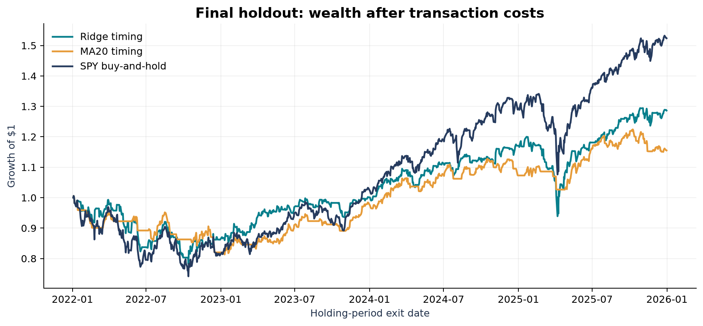

# DSA5205 Project 2: Regularized SPY Market Timing

A complete historical research workflow: daily market data -> trailing features -> monthly rolling Ridge fits -> forward validation -> a frozen, cost-aware 2022-2025 holdout. No broker integration or live trading.

**Main finding:** the model reduces some risk but does **not** outperform SPY buy-and-hold on net CAGR or Sharpe. The original result is retained rather than tuned away.

## Results

January 3, 2022 opening entry through December 31, 2025 opening liquidation; 1,002 holding intervals. Single-side transaction cost: **5 bps**, including initial entry and terminal liquidation. Cash interest and the Sharpe reference rate are assumed zero.

| Metric | Ridge timing | MA20 timing | SPY buy-and-hold |
|---|---:|---:|---:|
| CAGR | 6.54% | 3.69% | 11.18% |
| Annualized arithmetic return | 7.56% | 4.22% | 12.27% |
| Annualized volatility | 15.72% | 10.83% | 18.31% |
| Sharpe, rf = 0 | 0.481 | 0.389 | 0.670 |
| Maximum drawdown | -22.20% | -19.14% | -26.28% |
| Average equity exposure | 69.36% | 65.27% | 100.00% |
| Total one-way turnover | 246 | 102 | 2 |

The validation-only alpha grid is `[0.1, 1, 10, 100]`. Alpha **1** is selected by validation net Sharpe; ties choose stronger shrinkage. Test prediction R-squared against a past-only rolling historical mean is **-0.00541**. Ridge's zero-cost Sharpe is about **0.678**, falling to **0.481** at 5 bps.



## Deliverables

- [18-page LaTeX research report](output/pdf/Group_X_Report.pdf): seven-page two-column main paper and an eleven-page technical supplement.
- [Editable LaTeX sources and build instructions](paper/README.md); a standalone source ZIP is included in the release assets.
- [Derived tables](output/tables), [nine figures](output/figures), [selection lock](output/selection.json), and [data audit](output/data_audit.json).
- [Video script](output/video/walkthrough_script.md), [actual executed-stage log](output/video/demo_run.log), and [chapter metadata](output/video/chapters.json).
- Narrated MP4 and code ZIP: [release assets](https://github.com/SpencerMuZi/DSA5205-p2/releases/latest).
- [Chinese project guide](docs/PROJECT_GUIDE_ZH.md) and [submission checklist](docs/SUBMISSION_CHECKLIST.md).

**Team name, roster, and contribution fields are intentionally blank.** The video is a disclosed synthetic-narration review draft over real charts and captured command output. It is not team-member narration or a live screen recording. Review both report and video before submission.

## Setup

Python **3.12** is the tested version. Run from the repository root:

```bash
python3.12 -m venv .venv
source .venv/bin/activate
python -m pip install -r requirements.txt
python -m pytest -q
```

Report typesetting additionally requires [Tectonic](https://tectonic-typesetting.github.io/) (tested: 0.17.0) or a TeX distribution with `latexmk`. On macOS, install with `brew install tectonic`; first compilation downloads TeX packages and fonts. The report source is also suitable for a standard LaTeX editor; see [paper/README.md](paper/README.md).

On Windows, activate with `.venv\Scripts\activate`. Core analysis and report generation are cross-platform. Automated voice synthesis uses macOS `say`; the finished MP4 is provided separately so macOS is not needed to reproduce the research.

`requirements.txt` pins the direct dependencies. `requirements-lock.txt` records the clean-install transitive environment; use `python -m pip install -r requirements-lock.txt` for the closest environment match. Platform-specific wheels can still produce small numerical/rendering differences.

## Clean-checkout reproduction

The recommended command writes a **separate run**, preserving the published result and its input/selection fingerprints:

```bash
python -m project2.pipeline all --workspace runs/reproduction
python -m project2.report --workspace runs/reproduction
```

This downloads Yahoo history into `runs/reproduction/data/raw/spy_daily.csv`, performs the calendar/data audit, evaluates four validation candidates, locks alpha, evaluates only the chosen holdout model, saves tables/figures, and creates `runs/reproduction/output/pdf/Group_X_Report.pdf`.

Expected console output includes **4,024 sessions**, **64 dividend events**, **0 splits**, **alpha=1**, and the metric table above, conditional on matching vendor data. Yahoo may revise adjusted histories. Check `data/provenance.json` and raw SHA-256 digests before claiming exact numerical reproduction. A changed download is a new input snapshot, not permission to tune on the holdout.

Within a workspace with cached data, reruns use that cache. Never pass `--refresh` to an established run unless you intend to check for upstream revisions; changed data cause the selection lock to refuse overwriting the original experiment.

The same commands without `--workspace` operate on the repository's root `data/` and `output/`. This is useful with an authorized local input matching the published digest. The raw price CSV is deliberately **not** included in Git or the code ZIP.

## Individual stages

For a separate run, append `--workspace runs/reproduction` to each pipeline command:

```bash
python -m project2.pipeline fetch
python -m project2.pipeline validate
python -m project2.pipeline test
python -m project2.pipeline figures
python -m project2.report
```

`validate` selects alpha before `test`. `test` checks the protocol, input, and validation-table fingerprints. Repeating an identical frozen pipeline for reproducibility is allowed; it does not create a new independent holdout.

## Research protocol

| Design choice | Frozen setting |
|---|---|
| Asset | SPY, USD |
| Requested history | 2010-01-01 inclusive to 2026-01-01 exclusive |
| Initial development | 2010-2018 |
| Forward validation | Holding intervals within 2019-2021 |
| Final holdout | Holding intervals within 2022-2025 |
| Features | Adjusted returns over 1/5/20 sessions, MA20 gap, 20-session return SD |
| Model | Training-only StandardScaler -> Ridge, SVD solver |
| Rolling window | Most recent 1,260 fully realized labels; minimum 1,000 |
| Refitting | First signal, then first decision session of each new calendar month |
| Only selected parameter | Ridge alpha: 0.1 / 1 / 10 / 100 |
| Selection rule | Highest validation net Sharpe at 5 bps; ties within 1e-12 choose larger alpha |
| Position map | Prediction > 0: SPY weight 1; otherwise cash weight 0 |
| Decision / execution | After close t / open t+1 |
| Holding interval | Open t+1 to open t+2 |
| Benchmark rules | SPY buy-and-hold; fixed close > MA20 timing |
| Costs | 5 bps main; 0/10 bps sensitivity with the same positions |
| Rates / constraints | Cash = 0, Sharpe rf = 0, no leverage, no shorting |

The configuration was fixed before the first download in this implementation on 2026-11-09. This is **not** an externally preregistered historical experiment. The test years were already in the past at design time.

### Label and distribution accounting

For a signal at close t:

```text
target[t] = (raw_open[t+2] + dividend_ex_date[t+2]) / raw_open[t+1] - 1
```

A purchase at the ex-date open is not entitled to that day's distribution. Holding into the next ex-date open is entitled. The code credits an ex-date dividend receivable at exit, abstracting from actual payment-date cash. SPY has no splits in this sample; an observed split causes explicit failure pending an extended share-accounting implementation.

At fit date t, training labels must satisfy `exit_date <= t`; the preceding signal row alone is not enough to determine eligibility. Full-history adjusted price **levels** are not predictors. Trailing ratios/returns are invariant to a common later backward-adjustment factor; arbitrary vendor revisions remain a limitation.

### Fees and performance conventions

```text
turnover[t] = abs(weight[t] - weight[t-1]), with previous weight initially 0
growth[t] = (1 - cost * turnover[t]) * (1 + weight[t] * target[t])
growth[last] *= (1 - cost * weight[last])  # terminal liquidation
```

Cost is a stated pre-trade-equity haircut. It is not a detailed brokerage execution model. Binary weights avoid intermediate allocation drift. Annualization uses 252 holding intervals; maximum drawdown includes the initial wealth peak. Annual results use the continuous path without artificial year-end liquidation.

`output/exposure_diagnostic.json` is explicitly **ex post and gross**: it uses test-average exposure, so it is not an investable or pre-specified alternative strategy.

## Tests and clean-environment check

`tests/test_integrity.py` covers label/execution alignment, ex-date entitlement, future-price perturbations, adjusted-feature invariance, label maturity, training-only scaling, monthly refits, fee timing, cash positions, period boundaries, invalid data, and initial-capital drawdown. Synthetic fixtures are used only in these tests.

[The clean-environment check](output/reproducibility_check.json) uses a fresh isolated virtual environment and fresh work directory with the **same downloaded input snapshot**. The validation grid, final predictions, fit audits, and metric CSVs match the original byte for byte. This is not represented as a fresh independent market-data sample.

GitHub Actions runs the integrity suite and compiles the LaTeX report from the checked-in derived results; it deliberately does not download changing market data during CI. The build checks for overflowing boxes, unresolved references, unchanged result-source digests, and the assignment's 15-25 page range.

## Report identity and video updates

Fill `team_name`, `team_members`, and `contributions` in `config.json`, then run `python -m project2.report`. Authorship metadata is excluded from the research protocol hash, so filling names does not alter the selected model. Rename `Group_X_Report.pdf` to your actual group number.

On macOS, to capture actual staged rerun output and rebuild the synthetic walkthrough:

```bash
python -m project2.demo
python -m project2.video
python -m project2.video --render
```

`demo` uses the root local cache and frozen result settings; it does not select new strategies. `video` builds a review script and frames. `--render` requires the installed Samantha voice and FFmpeg from `imageio-ffmpeg`, produces a 15-25 minute MP4, and verifies duration. Temporary audio/segments stay in ignored `tmp/`.

## Source map

| File | Responsibility |
|---|---|
| `project2/data.py` | Data download, provenance, exchange calendar, corporate actions |
| `project2/core.py` | Features, labels, mature training windows, fitting, fees, metrics |
| `project2/pipeline.py` | Stage orchestration, validation lock, test results |
| `project2/figures.py` | Saved-result plots |
| `project2/report.py` | LaTeX compilation, reference/layout checks, and PDF build manifest |
| `project2/paper_assets.py` | Frozen-result tables, numeric macros, vector figures, and cost-attribution checks |
| `paper/main.tex` | Conference-style manuscript and technical supplement |
| `project2/demo.py` | Actual stage commands and outputs |
| `project2/video.py` | Script, frames, synthetic narration, MP4 |
| `tests/test_integrity.py` | Accounting and leakage regression tests |

## Data and method references

- [yfinance historical download documentation](https://ranaroussi.github.io/yfinance/reference/api/yfinance.download.html).
- [scikit-learn Ridge](https://scikit-learn.org/stable/modules/generated/sklearn.linear_model.Ridge.html) and [StandardScaler](https://scikit-learn.org/stable/modules/generated/sklearn.preprocessing.StandardScaler.html).
- [Exchange calendars](https://github.com/gerrymanoim/exchange_calendars).
- Chinco, Clark-Joseph, and Ye (2019), [Sparse Signals in the Cross-Section of Returns](https://doi.org/10.1111/jofi.12733), and Kelly, Malamud, and Zhou (2024), [The Virtue of Complexity in Return Prediction](https://doi.org/10.1111/jofi.13298): assignment-provided context, not replicated implementations.

The course assignment PDF is not redistributed. No secrets, account data, raw vendor price history, or live-trading functionality are included. AI implementation assistance is disclosed in the report; team members should review and understand the artifacts and follow applicable course rules.
